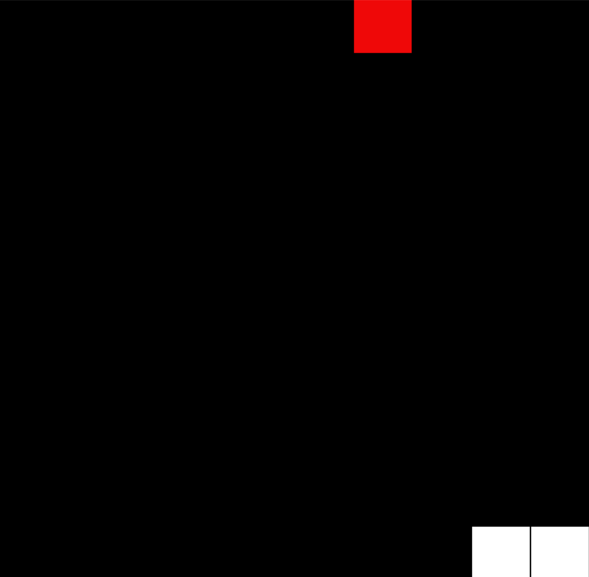
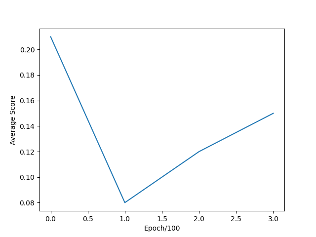

# Snake DQN

An AI that learns to play Snake from the pixels of the game board, using a convolutional Deep Q-Network.



*The game during training: the white blocks are the snake and the red block is the apple.*

## The idea

Instead of hand-coding rules, the agent looks at the game board like an image and learns which direction to move from the rewards it gets: a reward for eating an apple, a penalty for dying and a tiny penalty for every step (so it doesn't wander forever).

## How it works

**Environment (`snake_environment.py`, Pygame):**

- 10×10 grid with the snake drawn as 0.5 and the apple as 1
- Actions: up, down, right and left (it can't reverse straight into itself)
- Rewards: **+2** for an apple, **−1** for hitting a wall or itself, **−0.03** per step

**State:** the last **4 frames** stacked together (10×10×4), so the network can see which direction the snake is moving.

**Brain (`snake_brain.py`, Keras CNN):**

```
Conv2D(32, 3×3, ReLU) → MaxPooling(2×2) → Conv2D(64, 2×2, ReLU)
→ Flatten → Dense(256, ReLU) → Dense(4)   # one Q-value per action
```

**Training (`snake_train.py` with `snake_DQN.py`):**

- Experience replay memory of 60,000 transitions, batch size 32, γ = 0.9, learning rate 0.0001
- ε-greedy exploration: ε starts at 1.0 and drops by 0.0002 per game, down to 0.05
- Saves the model to `model2.keras` whenever it beats its best score
- Every 100 games, plots the average apples per game to `stats.png`

## Files

| File | Purpose |
|---|---|
| `snake_environment.py` | The Snake game and its reward logic |
| `snake_brain.py` | CNN model, plus loading a saved model |
| `snake_DQN.py` | Experience replay and building Q-learning targets |
| `snake_train.py` | Training loop |
| `snake_test.py` | Watch the saved model play |
| `model2.keras` | Saved model |
| `stats.png` | Training curve |

## Training note



Because of local hardware limits, I trained only for a short run (about 400 games), which is what this chart shows. At that point ε is still high (around 0.92), so the agent is mostly exploring. ε reaches its minimum after about 4,750 games, so a longer run on a GPU is the next step for real performance.

## Run it

```bash
pip install tensorflow keras pygame numpy matplotlib
python snake_train.py   # train (runs until you stop it)
python snake_test.py    # watch the saved model play
```

## What I learned

- Using a CNN as the Q-function so the agent can learn from a grid "image" instead of hand-picked features.
- Frame stacking to give a single-frame model a sense of motion.
- How slow ε decay makes early training curves look flat or noisy, and how to read a training curve honestly.

## Credits

Based on a project from *AI Crash Course* by Hadelin de Ponteves (Packt), studied and extended as part of my [machine-learning](https://github.com/zzzhtetpai-neuroai/machine-learning) learning path.
